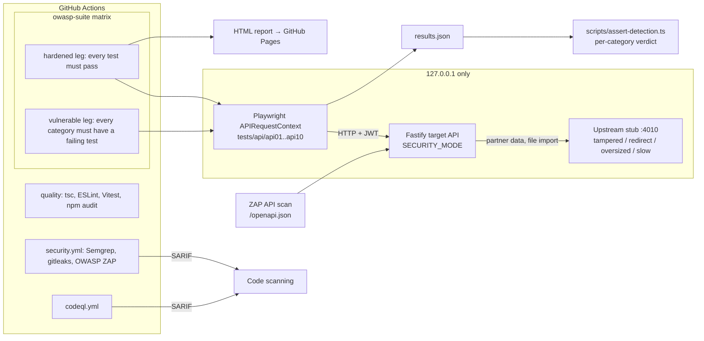

# API Security Test Suite

[](https://github.com/yonduudontaxx/api-security-test-suite/actions/workflows/ci.yml)
[](https://github.com/yonduudontaxx/api-security-test-suite/actions/workflows/security.yml)
[](https://github.com/yonduudontaxx/api-security-test-suite/actions/workflows/codeql.yml)
[](https://yonduudontaxx.github.io/api-security-test-suite/)

An automated test suite for the [OWASP API Security Top 10 (2023)](https://owasp.org/API-Security/editions/2023/en/0x11-t10/), written with Playwright Test and TypeScript. It runs against a small Fastify API that can start in two modes: `vulnerable`, with a seeded flaw for every category, and `hardened`, with each flaw fixed. CI runs the same suite against both. The hardened run must pass every test. The vulnerable run must fail at least one test in every category. If a category's flaw goes undetected, the build fails. That way the pipeline checks the security tests themselves for false positives and false negatives.

**Live report:** <https://yonduudontaxx.github.io/api-security-test-suite/>. This is the Playwright HTML report from the latest hardened run on `main`.

> [!WARNING]
> `SECURITY_MODE=vulnerable` is intentionally insecure. It accepts unsigned JWTs, follows SSRF payloads and serves its signing key from `/debug/config`. The server binds to `127.0.0.1` only. Never expose it or deploy it. See [SECURITY.md](SECURITY.md).

## How the proof works



1. `npx playwright test` starts the upstream stub and the target API through `webServer`. A random JWT secret and admin password are generated for each run, so no secrets live in the repository.
2. Each spec is tagged with its category (`@API1` … `@API10`). The tests assert the **secure** behaviour, for example `expect(status).toBe(404)` when Bob requests Alice's order.
3. `scripts/assert-detection.ts` reads the JSON report and gives each category a verdict. On the hardened leg every category must be `SECURE`. On the vulnerable leg every category must be `DETECTED`, and the leg fails on any `MISSED`.
4. Positive controls, such as an owner reading their own order or an allowlisted import succeeding, pass in both modes. They show that each control is not just blocking everything.

## Category coverage

| OWASP API 2023 | Seeded flaw (`vulnerable`) | Tests | Fix (`hardened`) |
| --- | --- | --- | --- |
| **API1** Broken Object Level Authorization | Orders are fetched, cancelled and discounted by ID with no owner check, and `?ownerId=` lists another user's orders | [`api01-bola.spec.ts`](tests/api/api01-bola.spec.ts) | Lookups are scoped to the caller (or admin). Foreign IDs return `404`, not `403`, so IDs cannot be enumerated |
| **API2** Broken Authentication | Accepts `alg=none` in any casing, ignores `exp`, has no login lockout, and returns different errors for unknown users and wrong passwords | [`api02-broken-authentication.spec.ts`](tests/api/api02-broken-authentication.spec.ts) | Pins HS256, compares signatures in constant time, requires `exp`/`iat` and rejects future `iat`, locks an account for 15 minutes after 5 failures, and gives one generic error |
| **API3** Broken Object Property Level Authorization | Responses include `passwordHash`, `resetToken` and `mfaSecret`. `PATCH /users/me` and register accept `role` and `balanceCents` | [`api03-bopla.spec.ts`](tests/api/api03-bopla.spec.ts) | Separate private and public views, plus input allowlists that reject unknown fields |
| **API4** Unrestricted Resource Consumption | Page size is uncapped, the body limit is 10 MB, the line-item count is unlimited, and there is no rate limit | [`api04-resource-consumption.spec.ts`](tests/api/api04-resource-consumption.spec.ts) | `limit` is capped at 1 to 100, the body limit is 16 KB (`413`), orders take at most 20 items, and each user gets 100 requests per minute (`429` + `Retry-After`) |
| **API5** Broken Function Level Authorization | `/admin/*` checks only that the caller is authenticated | [`api05-bfla.spec.ts`](tests/api/api05-bfla.spec.ts) | Role check on the server, using the stored role rather than the token claim |
| **API6** Unrestricted Access to Sensitive Business Flows | The single-use coupon is checked, then marked redeemed after an `await`, so concurrent requests all win. Negative and huge quantities are accepted | [`api06-business-flows.spec.ts`](tests/api/api06-business-flows.spec.ts) | Check and mark happen in one step before any `await`, and quantity must be 1 to 50 |
| **API7** Server Side Request Forgery | `POST /files/import` fetches any URL, including `file://`, follows redirects, and accepts credentials in URLs | [`api07-ssrf.spec.ts`](tests/api/api07-ssrf.spec.ts) | Exact-origin allowlist, http(s) only, no userinfo, `redirect: 'manual'`, plus timeout and size limits |
| **API8** Security Misconfiguration | Reflects any CORS origin with credentials, returns stack traces in error bodies, sends `X-Powered-By` and a `Server` version, and sets no hardening headers | [`api08-misconfiguration.spec.ts`](tests/api/api08-misconfiguration.spec.ts) | CORS origin allowlist, generic error bodies, and `nosniff`, `no-store`, CSP `frame-ancestors 'none'`, `X-Frame-Options`, HSTS and CORP |
| **API9** Improper Inventory Management | The undocumented `/api/v0/users` (no auth, full records) and `/debug/config` are still live | [`api09-inventory.spec.ts`](tests/api/api09-inventory.spec.ts) | Only documented routes are served. The tests derive shadow-version probes from `/openapi.json` and check that every operation declares security |
| **API10** Unsafe Consumption of APIs | The partner endpoint relays upstream JSON without checks: HTML/JS payloads, out-of-range discounts and extra fields, followed redirects, unbounded size, and no timeout | [`api10-unsafe-consumption.spec.ts`](tests/api/api10-unsafe-consumption.spec.ts) | Strict schema validation, no redirects, a 64 KB cap and a 1.5 s timeout (`502`/`504`) |

Unit tests in [`tests/unit`](tests/unit) cover the guards directly: JWT verification, URL allowlist, password hashing, rate limiter, lockout and input parsers.

## Quick start

Requires Node.js 22.12 or later.

```bash
npm ci
npm start                       # hardened target on http://127.0.0.1:3000 (OpenAPI at /openapi.json)

npm run test:api                # suite against the hardened target (starts its own servers)
npm run assert:hardened         # per-category verdict: every category SECURE

npm run test:api:vulnerable     # suite against the vulnerable target, failures expected
npm run assert:vulnerable       # per-category verdict: every category DETECTED

npm run test:unit && npm run typecheck && npm run lint
npx playwright show-report      # browse the last run
```

Configuration (all optional):

| Variable | Default | Purpose |
| --- | --- | --- |
| `SECURITY_MODE` | `hardened` | `hardened` or `vulnerable` |
| `PORT` | `3000` | Listen port. The host is always `127.0.0.1` |
| `JWT_SECRET` | random per start | HS256 signing key |
| `ADMIN_PASSWORD` | random per start | Password for the seeded `admin` account |
| `UPSTREAM_URL` | `http://127.0.0.1:4010` | Partner and file service (`npm run start:upstream` runs the stub) |
| `IMPORT_ALLOWED_ORIGINS` | origin of `UPSTREAM_URL` | Comma-separated SSRF allowlist |
| `CORS_ALLOWED_ORIGINS` | `https://app.example.test` | Comma-separated CORS allowlist |
| `RATE_LIMIT_PER_MINUTE` | `100` | Per-user request budget |

## CI pipeline

| Workflow | What it enforces |
| --- | --- |
| [`ci.yml`](.github/workflows/ci.yml) | Typecheck, ESLint, Vitest, `npm audit --audit-level=high`, the two-leg OWASP suite matrix on Node 22, and publishing the hardened HTML report to GitHub Pages |
| [`security.yml`](.github/workflows/security.yml) | Semgrep (`p/owasp-top-ten`, `p/typescript`) → SARIF, gitleaks over full history → SARIF, and an authenticated OWASP ZAP API scan of `/openapi.json` against the hardened target, where any unignored alert fails the job ([rules](.zap/rules.tsv)) |
| [`codeql.yml`](.github/workflows/codeql.yml) | CodeQL `security-extended` for JavaScript/TypeScript |

Workflows run with `contents: read` by default. Only the jobs that need extra scopes get them: SARIF upload, Pages deploy.

CodeQL and Semgrep are expected to report the deliberate flaws in the vulnerable branches. That shows the SAST layer catching the same classes of bug the dynamic suite proves. See [SECURITY.md](SECURITY.md).

## Project layout

```
src/
  app.ts               Fastify app, CORS, headers, error handling, auth hook
  routes/              auth, users, orders (coupons), integrations (import, partners), admin
  security/            jwt, password, url-guard, outbound fetch limits, throttle
  validation.ts        input allowlists and parsers
  openapi.ts           OpenAPI 3.1 document served at /openapi.json
tests/
  api/                 one Playwright spec per OWASP category
  unit/                Vitest unit tests for the guards
  support/             request helpers, token crafting, upstream stub
scripts/assert-detection.ts   per-category verdict from the Playwright JSON report
```

## License

[MIT](LICENSE) © Joshua Maigeri
