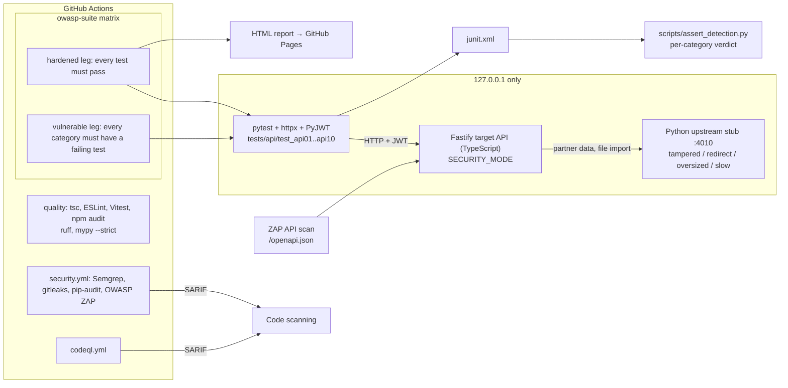

# API Security Test Suite

[](https://github.com/yonduudontaxx/api-security-test-suite/actions/workflows/ci.yml)
[](https://github.com/yonduudontaxx/api-security-test-suite/actions/workflows/security.yml)
[](https://github.com/yonduudontaxx/api-security-test-suite/actions/workflows/codeql.yml)
[](https://yonduudontaxx.github.io/api-security-test-suite/)

An automated test suite for the [OWASP API Security Top 10 (2023)](https://owasp.org/API-Security/editions/2023/en/0x11-t10/), written in Python with pytest, httpx and PyJWT. It runs against a small TypeScript/Fastify API that can start in two modes: `vulnerable`, with a seeded flaw for every category, and `hardened`, with each flaw fixed. CI runs the same suite against both. The hardened run must pass every test. The vulnerable run must fail at least one test in every category. If a category's flaw goes undetected, the build fails. That way the pipeline checks the security tests themselves for false positives and false negatives.

**Live report:** <https://yonduudontaxx.github.io/api-security-test-suite/>. This is the pytest-html report from the latest hardened run on `main`.

> [!WARNING]
> `SECURITY_MODE=vulnerable` is intentionally insecure. It accepts unsigned JWTs, follows SSRF payloads and serves its signing key from `/debug/config`. The server binds to `127.0.0.1` only. Never expose it or deploy it. See [SECURITY.md](SECURITY.md).

## How the proof works



1. `pytest` starts the upstream stub and the target API in a session fixture (`apisec_suite/stack.py`). A random JWT secret and admin password are generated for each run, so no secrets live in the repository. Set `BASE_URL`, `JWT_SECRET` and `ADMIN_PASSWORD` to point the suite at a target that is already running instead.
2. Each module carries one category marker (`api1` … `api10`). Collection fails if a test has no marker or more than one. The marker is written into the JUnit report as an `owasp_category` property. The tests assert the **secure** behaviour, for example `assert response.status_code == 404` when Bob requests Alice's order.
3. `scripts/assert_detection.py` reads the JUnit report and gives each category a verdict. Skipped tests fail the check. On the hardened leg every category must be `SECURE`. On the vulnerable leg every category must be `DETECTED`, and the leg fails on any `MISSED`.
4. Positive controls, such as an owner reading their own order or an allowlisted import succeeding, pass in both modes. They show that each control is not just blocking everything.

## Category coverage

| OWASP API 2023 | Seeded flaw (`vulnerable`) | Tests | Fix (`hardened`) |
| --- | --- | --- | --- |
| **API1** Broken Object Level Authorization | Orders are fetched, cancelled and discounted by ID with no owner check, and `?ownerId=` lists another user's orders | [`test_api01_bola.py`](tests/api/test_api01_bola.py) | Lookups are scoped to the caller (or admin). Foreign IDs return `404`, not `403`, so IDs cannot be enumerated |
| **API2** Broken Authentication | Accepts `alg=none` in any casing, ignores `exp`, has no login lockout, and returns different errors for unknown users and wrong passwords | [`test_api02_broken_authentication.py`](tests/api/test_api02_broken_authentication.py) | Pins HS256, compares signatures in constant time, requires `exp`/`iat` and rejects future `iat`, locks an account for 15 minutes after 5 failures from the same address (so an attacker elsewhere cannot lock the owner out), throttles each address after 20 failed logins a minute across all accounts, and gives one generic error |
| **API3** Broken Object Property Level Authorization | Responses include `passwordHash`, `resetToken` and `mfaSecret`. `PATCH /users/me` and register accept `role` and `balanceCents` | [`test_api03_bopla.py`](tests/api/test_api03_bopla.py) | Separate private and public views, plus input allowlists that reject unknown fields |
| **API4** Unrestricted Resource Consumption | Page size is uncapped, the body limit is 10 MB, the line-item count is unlimited, and there is no rate limit | [`test_api04_resource_consumption.py`](tests/api/test_api04_resource_consumption.py) | `limit` is capped at 1 to 100, the body limit is 16 KB (`413`), orders take at most 20 items, and each user gets 100 requests per minute (`429` + `Retry-After`) |
| **API5** Broken Function Level Authorization | `/admin/*` checks only that the caller is authenticated | [`test_api05_bfla.py`](tests/api/test_api05_bfla.py) | Role check on the server, using the stored role rather than the token claim |
| **API6** Unrestricted Access to Sensitive Business Flows | The single-use coupon is checked, then marked redeemed after an `await`, so concurrent requests all win. Negative and huge quantities are accepted | [`test_api06_business_flows.py`](tests/api/test_api06_business_flows.py) | Check and mark happen in one step before any `await`, a code is redeemed once per order owner whoever applies it, and quantity must be 1 to 50 |
| **API7** Server Side Request Forgery | `POST /files/import` fetches any URL, including `file://`, follows redirects, and accepts credentials in URLs | [`test_api07_ssrf.py`](tests/api/test_api07_ssrf.py) | Exact-origin allowlist, http(s) only, no userinfo, `redirect: 'manual'`, plus timeout and size limits |
| **API8** Security Misconfiguration | Reflects any CORS origin with credentials, returns stack traces in error bodies, sends `X-Powered-By` and a `Server` version, and sets no hardening headers | [`test_api08_misconfiguration.py`](tests/api/test_api08_misconfiguration.py) | CORS origin allowlist, generic error bodies, and `nosniff`, `no-store`, CSP `frame-ancestors 'none'`, `X-Frame-Options`, HSTS and CORP |
| **API9** Improper Inventory Management | The undocumented `/api/v0/users` (no auth, full records) and `/debug/config` are still live | [`test_api09_inventory.py`](tests/api/test_api09_inventory.py) | Only documented routes are served. The tests derive shadow-version probes from `/openapi.json` and check that every operation declares security |
| **API10** Unsafe Consumption of APIs | The partner endpoint relays upstream JSON without checks: HTML/JS payloads, out-of-range discounts and extra fields, followed redirects, unbounded size, and no timeout | [`test_api10_unsafe_consumption.py`](tests/api/test_api10_unsafe_consumption.py) | Strict schema validation, no redirects, a 64 KB cap and a 1.5 s timeout (`502`/`504`) |

TypeScript unit tests (Vitest) in [`tests/unit`](tests/unit) cover the target's guards directly: JWT verification, URL allowlist, password hashing, rate limiter, lockout and input parsers.

## Quick start

Requires Node.js 22.12 or later for the target API and Python 3.12 or later for the suite.

```bash
npm ci && npm start             # hardened target on http://127.0.0.1:3000 (OpenAPI at /openapi.json)

python3.12 -m venv .venv && . .venv/bin/activate
pip install -e ".[dev]"
pytest                          # suite against the hardened target (starts its own target and stub)

pytest --junitxml=reports/junit.xml && python scripts/assert_detection.py --mode hardened
SECURITY_MODE=vulnerable pytest --junitxml=reports/junit.xml; python scripts/assert_detection.py --mode vulnerable

pytest -m api7                  # one OWASP category
pytest --html=reports/html/index.html --self-contained-html
ruff check . && ruff format --check . && mypy
npm run test:unit && npm run typecheck && npm run lint
```

Target configuration (all optional):

| Variable | Default | Purpose |
| --- | --- | --- |
| `SECURITY_MODE` | `hardened` | `hardened` or `vulnerable` |
| `PORT` | `3000` | Listen port. The host is always `127.0.0.1` |
| `JWT_SECRET` | random per start | HS256 signing key |
| `ADMIN_PASSWORD` | random per start | Password for the seeded `admin` account |
| `UPSTREAM_URL` | `http://127.0.0.1:4010` | Partner and file service (`apisec-upstream` runs the stub) |
| `IMPORT_ALLOWED_ORIGINS` | origin of `UPSTREAM_URL` | Comma-separated SSRF allowlist |
| `CORS_ALLOWED_ORIGINS` | `https://app.example.test` | Comma-separated CORS allowlist |
| `RATE_LIMIT_PER_MINUTE` | `100` | Per-user request budget |
| `LOGIN_FAILURE_LIMIT_PER_MINUTE` | `20` | Failed logins allowed per client address per minute, across all accounts |

## CI pipeline

| Workflow | What it enforces |
| --- | --- |
| [`ci.yml`](.github/workflows/ci.yml) | Target: tsc, ESLint, Vitest, `npm audit --audit-level=high` on Node 22. Suite: ruff, ruff format and mypy `--strict` on Python 3.12. The two-leg OWASP suite matrix, and publishing the hardened pytest-html report to GitHub Pages |
| [`security.yml`](.github/workflows/security.yml) | Semgrep (`p/owasp-top-ten`, `p/typescript`, `p/python`) → SARIF, gitleaks over full history → SARIF, `pip-audit` on the Python suite, and an authenticated OWASP ZAP API scan of `/openapi.json` against the hardened target, where any unignored alert fails the job ([rules](.zap/rules.tsv)) |
| [`codeql.yml`](.github/workflows/codeql.yml) | CodeQL `security-extended` for JavaScript/TypeScript and Python |

Workflows run with `contents: read` by default. Only the jobs that need extra scopes get them: SARIF upload, Pages deploy.

CodeQL and Semgrep are expected to report the deliberate flaws in the vulnerable branches. That shows the SAST layer catching the same classes of bug the dynamic suite proves. See [SECURITY.md](SECURITY.md).

## Project layout

```
src/                     target API (TypeScript, Fastify)
  app.ts                 CORS, headers, error handling, auth hook
  routes/                auth, users, orders (coupons), integrations (import, partners), admin
  security/              jwt, password, url-guard, outbound fetch limits, throttle
  validation.ts          input allowlists and parsers
  openapi.ts             OpenAPI 3.1 document served at /openapi.json
apisec_suite/            test-suite support (Python)
  stack.py               starts the target and the upstream stub for a session
  upstream_stub.py       hostile upstream: tampered, redirect, oversized, slow
  client.py              request helpers and JWT forging (PyJWT)
scripts/
  assert_detection.py    per-category verdict from pytest JUnit XML
tests/
  api/                   one pytest module per OWASP category
  unit/                  Vitest unit tests for the target's guards
```

## License

[MIT](LICENSE) © Joshua Maigeri
